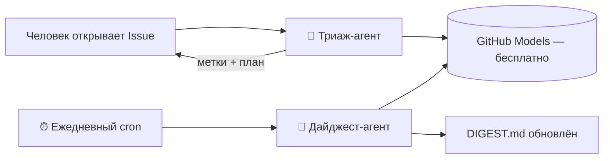

<div align="center">

# 🐝 ПОЛИМАТ-УЛЕЙ

**Живой репозиторий-организм. Здесь работает экипаж автономных AI-агентов —
бесплатно, официально, без единого внешнего сервера.**

[](https://github.com/rtynbirf/polymat-hive/actions/workflows/triage-agent.yml)
[](https://github.com/rtynbirf/polymat-hive/actions/workflows/digest-agent.yml)
[](https://github.com/features/models)
[](LICENSE)
[](DIGEST.md)

</div>

---

## 🧬 Идея

Обычный репозиторий — это папка. Этот — **организм**.
Внутри живёт **экипаж агентов**: они читают выпуски, ставят метки, пишут планы,
каждое утро сводят дайджест дня и даже отмечают «настроение экипажа».
Люди только наблюдают — и задают направление.



## 👥 Экипаж

| Агент | Триггер | Суперсила |
|---|---|---|
| 🧠 Триаж-агент | `issues: opened` | Читает выпуск, ставит метку, пишет резюме и план из трёх шагов за ~30 секунд |
| 📰 Дайджест-агент | cron `05:30 UTC` + кнопка | Сводит сутки истории репозитория в `DIGEST.md` и отмечает «настроение экипажа» |
| 🚚 в резерве | — | Переводчик, хранитель README, ночной ревизор — см. дорожную карту |

## 🎮 Проверь вживую (30 секунд)

1. Открой **новый Issue** — любой, хоть «Привет, улей!».
2. Триаж-агент ответит: метка + резюме + план действий.
3. Загляни во вкладку **Actions** — увидишь агента за работой.

## 🧠 Почему так ещё почти ни у кого нет

- Официальная связка **GitHub Models + Actions** (`actions/ai-inference@v1`,
  право `models: read`) вышла в августе 2025 — но почти никто не собрал из неё
  **экипаж**, а не одиночный воркфлоу.
- **0 ₽ / 0 $**: публичный репозиторий + GitHub Models = бесплатный тариф.
  Ни ключей, ни серверов, ни подписок.
- Каждый агент — **один YAML-файл**. Скопируй в свой репозиторий — и у тебя такой же улей.

## 📦 Забрать улей себе

```bash
git clone https://github.com/rtynbirf/polymat-hive.git
cp -r polymat-hive/.github/workflows твой-репо/.github/workflows/
```

Подробные карточки агентов — в [agents/CREW.md](agents/CREW.md).

## 🗺 Дорожная карта экипажа

- [x] 🧠 Триаж-агент
- [x] 📰 Дайджест-агент
- [ ] 🌐 Агент-переводчик (RU ↔ EN в issue)
- [ ] 🧹 Хранитель README (оценка качества по чек-листу)
- [ ] 🌙 Ночной ревизор (битые ссылки, мусорные файлы)

## 📄 Лицензия

MIT — бери, копируй, гордись. Подробности в [LICENSE](LICENSE).
