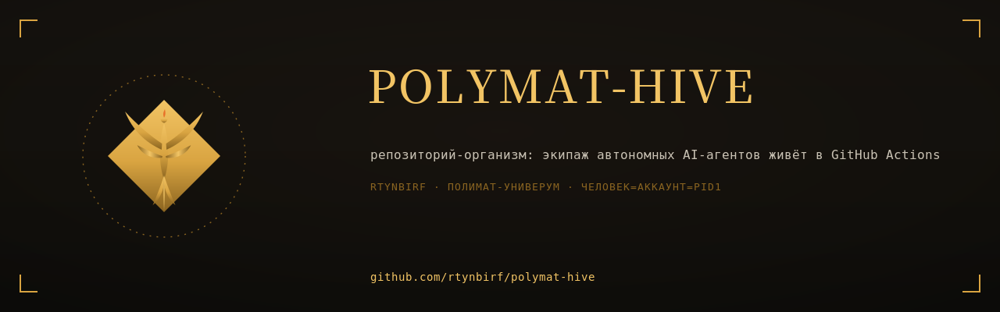
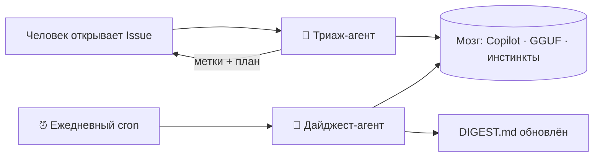

<div align="center">

# 🐝 ПОЛИМАТ-УЛЕЙ

<div align="center">
  
</div>

<!--ФОРЖ:МУЗА:НАЧАЛО-->
<div align="center">
  
  <br/>
  
</div>
<!--ФОРЖ:МУЗА:КОНЕЦ-->


**Живой репозиторий-организм. Здесь работает экипаж автономных AI-агентов —
без единого внешнего сервера, с трёхэтажным мозгом.**

[](https://github.com/rtynbirf/polymat-hive/actions/workflows/triage-agent.yml)
[](https://github.com/rtynbirf/polymat-hive/actions/workflows/digest-agent.yml)
[](https://github.com/rtynbirf/polymat-hive/actions/workflows/doctor-agent.yml)
[](agents/CREW.md)
[](LICENSE)
[](DIGEST.md)

</div>

---

## 🧬 Идея

Обычный репозиторий — это папка. Этот — **организм**.
Внутри живёт **экипаж агентов**: они читают выпуски, ставят метки, пишут планы,
каждое утро сводят дайджест дня и даже отмечают «настроение экипажа».
Люди только наблюдают — и задают направление.



## 👥 Экипаж

| Агент | Триггер | Суперсила |
|---|---|---|
| 🧠 Триаж-агент | `issues: opened` | Читает выпуск, ставит метку, пишет резюме и план из трёх шагов за ~1 минуту |
| 📰 Дайджест-агент | cron `05:30 UTC` + кнопка | Сводит сутки истории репозитория в `DIGEST.md` и отмечает «настроение экипажа» |
| 🩺 Доктор улея | еженедельно + кнопка | Проверяет все три этажа мозга и сообщает диагноз |
| 🚚 в резерве | — | Переводчик, хранитель README, ночной ревизор — см. дорожную карту |

## 🧠 Три этажа мозга (суверенность в кубе)

1. **Copilot CLI** — если секрет `COPILOT_PAT` задан и Copilot включён.
2. **Локальный нейромозг GGUF** — модель `Qwen2.5-0.5B-Instruct` (Q4_K_M)
   скачивается на раннер Actions и думает прямо там: **ни одного ключа,
   ни одного внешнего сервиса**. Кэшируется между запусками.
3. **Инстинкты** — эвристики без модели. Улей молчать не умеет.

## 🎮 Проверь вживую (60 секунд)

1. Открой **новый Issue** — любой, хоть «Привет, улей!».
2. Триаж-агент ответит: метка + резюме + план действий.
3. Загляни во вкладку **Actions** — увидишь, каким этажом мозга думал агент.

## 🧠 Почему так ещё почти ни у кого нет

- Официальный экшен **`actions/ai-inference@v3`** (июль 2026) прогоняет LLM
  через Copilot CLI прямо в GitHub Actions — но почти никто не собрал из него
  **экипаж**, а не одиночный воркфлоу.
- **Локальный GGUF-нейромозг на раннере** — нейросеть работает внутри
  бесплатного воркфлоу, без API-ключей и подписок. Полная офлайн-суверенность.
- **Деградация graceful**: мозг выключен — экипаж переходит на этаж ниже
  и всё равно отвечает. Организм не умирает.
- Каждый агент — **один YAML-файл**. Скопируй в свой репозиторий — и у тебя такой же улей.

## 📦 Забрать улей себе

```bash
git clone https://github.com/rtynbirf/polymat-hive.git
cp -r polymat-hive/.github/workflows твой-репо/.github/workflows/
```

Секрет `COPILOT_PAT` — опционален: без него улей живёт на локальном мозге.
Карточки агентов и инструкция — в [agents/CREW.md](agents/CREW.md).

## 🗺 Дорожная карта экипажа

- [x] 🧠 Триаж-агент
- [x] 📰 Дайджест-агент
- [x] 🩺 Доктор улея
- [ ] 🌐 Агент-переводчик (RU ↔ EN в issue)
- [ ] 🧹 Хранитель README (оценка качества по чек-листу)
- [ ] 🌙 Ночной ревизор (битые ссылки, мусорные файлы)

## 📄 Лицензия

MIT — бери, копируй, гордись. Подробности в [LICENSE](LICENSE).

<!--ФОРЖ:ПОДВАЛ-->
---

<div align="center">
  <sub>◆ картина и штандарт — ручная ковка <a href="https://github.com/rtynbirf">КУЗНИ ПОЛИМАТ</a> · ЧЕЛОВЕК=АККАУНТ=PID1 ◆</sub>
</div>
